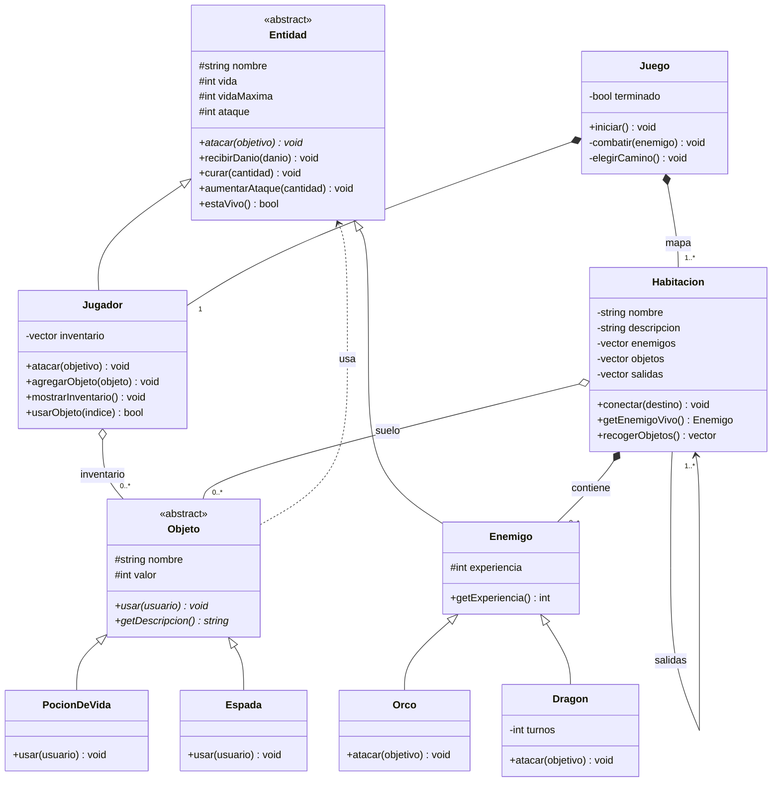

# Operación Jaque

Juego de rol (RPG) de aventura textual para consola, hecho en **C++17** con **CLion**.
Proyecto final de **Programación Orientada a Objetos 2026-2** (Pontificia Universidad Javeriana Cali).

## Historia

El Dragón ha secuestrado al Rey y lo mantiene encadenado en su guarida, al fondo de la montaña. Sus orcos vigilan cada rincón. La única esperanza es la **Operación Jaque**: una misión secreta de un solo soldado.

**Objetivo:** llegar a la Guarida, derrotar al Dragón y rescatar al Rey.

## Cómo jugar

- Al iniciar recibes una **Espada de hierro** y una **Poción pequeña**.
- En cada habitación eliges a dónde ir con un menú numerado.
- Si hay un enemigo, comienza un **combate por turnos**: atacar o usar un objeto.
- Los objetos **solo se pueden usar durante un combate**. Fuera de combate solo puedes ver el inventario.
- Ganas al derrotar al Dragón. Pierdes si tu vida llega a 0.

## Cómo compilar y ejecutar

Requisitos: CMake 3.20 o superior y un compilador compatible con C++17.

```bash
git clone https://github.com/Juanjorojasc/Proyecto-Final_POO.git
cd Proyecto-Final_POO
cmake -S . -B build
cmake --build build
./build/PROYECTO_FINAL
```

En CLion: abrir la carpeta del proyecto, *Reload CMake Project* y ejecutar `PROYECTO_FINAL`.

## Estructura del proyecto

| Clase | Descripción |
|-------|-------------|
| `Entidad` | Clase base **abstracta** (`atacar()` virtual pura). Vida, ataque y nombre. |
| `Jugador` | Hereda de `Entidad`. Tiene un inventario (`std::vector`). |
| `Enemigo` | Hereda de `Entidad`. Clase intermedia con la experiencia. |
| `Orco`, `Dragon` | Hijos de `Enemigo`, cada uno con su propio ataque. |
| `Objeto` | Clase base **abstracta** (`usar()` virtual pura). |
| `PocionDeVida`, `Espada` | Hijos de `Objeto`, cada uno se usa a su manera. |
| `Habitacion` | Descripción, enemigos, objetos y salidas a otras habitaciones. |
| `Juego` | Controla el mapa, el bucle principal, el movimiento y el combate. |

## Los 4 pilares de la POO en el proyecto

- **Encapsulamiento:** los atributos son privados o protegidos y se acceden mediante métodos (por ejemplo, la vida solo cambia con `recibirDanio()` y `curar()`, que validan los límites).
- **Abstracción:** `Entidad` y `Objeto` son clases abstractas que definen un contrato (`atacar()`, `usar()`) sin implementarlo.
- **Herencia:** `Jugador` y `Enemigo` heredan de `Entidad`; `Orco` y `Dragon` heredan de `Enemigo`; `PocionDeVida` y `Espada` heredan de `Objeto`.
- **Polimorfismo:** el mismo llamado `enemigo.atacar()` o `objeto->usar()` produce un comportamiento distinto según el tipo real del objeto.

## Memoria y STL

- Contenedores: `std::vector` para el inventario, los enemigos, los objetos, las salidas y el mapa.
- Memoria dinámica con punteros inteligentes: `std::unique_ptr` y `std::make_unique`, sin `new` ni `delete` manuales.

## Diagrama de clases (UML)



## Equipo

| Integrante | GitHub | Responsabilidades |
|------------|--------|-------------------|
| Juan Rojas | [@Juanjorojasc](https://github.com/Juanjorojasc) | (completar) |
| (nombre del compañero) | (usuario) | (completar) |

## Características adicionales (bonus)

- [ ] Sistema de niveles y experiencia
- [ ] Armaduras que reducen el daño
- [ ] Jefe final con habilidades únicas
- [ ] Guardar y cargar partida
